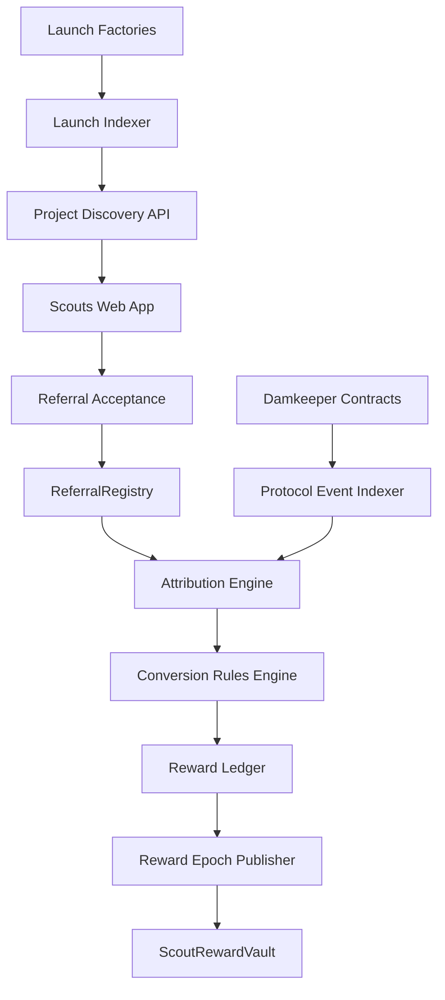
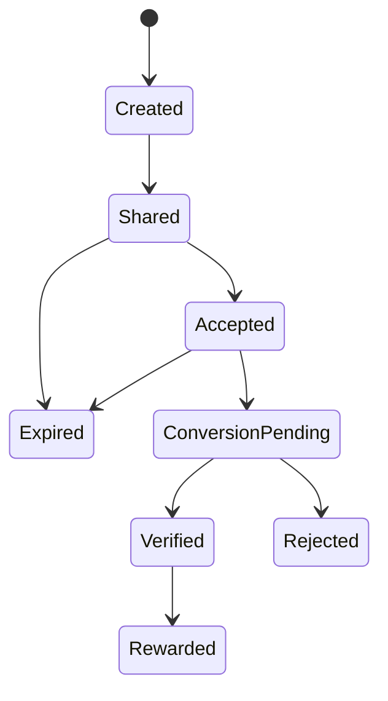
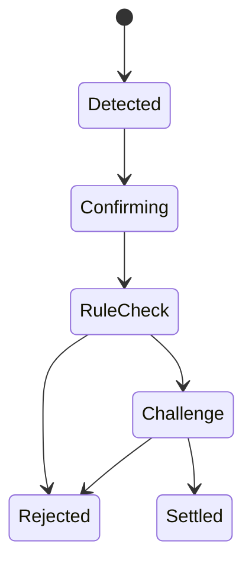

# Damkeeper Scouts

## Product and Technical Architecture Brief

**Document status:** Draft v0.1  
**Target network:** Robinhood Chain  
**Mainnet chain ID:** 4663  
**Rollout:** Testnet first, then controlled mainnet beta  
**Product owner:** Damkeeper  

---

## 1. Executive Summary

Damkeeper Scouts is a community powered growth and referral layer for Damkeeper.

The system detects newly launched tokens on Robinhood Chain, presents them to eligible $DAM holders, and lets those holders introduce project teams to Damkeeper products such as token locks, vesting, staking, burns, and airdrops.

A Scout is not rewarded for clicks, impressions, or posting a referral link. A reward becomes eligible only when:

1. A valid project creator accepts the referral.
2. The project completes a qualifying Damkeeper action.
3. The action is confirmed and verified onchain.
4. The referral and action pass anti abuse checks.

The product loop is:

> Discover → Refer → Adopt → Verify → Reward

Damkeeper Scouts should turn $DAM holders into a measurable distribution network while protecting the protocol from spam, self referrals, dust transactions, duplicate rewards, and fake adoption.

---

## 2. Product Thesis

Robinhood Chain may produce many new token launches, but new projects still need infrastructure after launch.

They need to:

1. Lock treasury, team, or liquidity allocations.
2. Create transparent vesting schedules.
3. Launch and fund staking pools.
4. Burn token supply with public proof.
5. Distribute tokens through claim based airdrops.

Damkeeper already provides the infrastructure. Scouts adds a community acquisition layer that helps those projects discover and adopt it.

The network should reward real protocol adoption, not social activity alone.

---

## 3. Goals

### Primary goals

1. Detect new token launches on Robinhood Chain.
2. Give $DAM participants a structured way to introduce projects to Damkeeper.
3. Attribute each accepted referral to the correct Scout.
4. Verify successful adoption through Damkeeper contract events.
5. Reward measurable adoption with transparent rules.
6. Create a repeatable acquisition channel for Damkeeper.

### Secondary goals

1. Increase usage of locks, vesting, staking, burns, and airdrops.
2. Give $DAM additional participation utility.
3. Build a public history of Scout performance.
4. Give project teams a single onboarding path into the Damkeeper product suite.

### Non goals for V1

1. Paying users for impressions, likes, reposts, or link clicks.
2. Building a general purpose affiliate platform for unrelated protocols.
3. Automatically contacting project teams through private social accounts.
4. Rewarding every protocol transaction without limits.
5. Using an uncapped $DAM emissions schedule.
6. Supporting every DEX and launchpad at the first release.

---

## 4. Recommended V1 Decisions

These defaults allow development to begin without waiting for every business decision.

| Area | Recommended V1 decision | Reason |
| --- | --- | --- |
| Launch source | Start with Pons and known factory contracts | Reliable creator and launch attribution |
| Scout eligibility | Require an active $DAM staking position | Stronger than a temporary wallet balance check |
| Referral ownership | Project creator must accept the referral | Prevents lead squatting and fake claims |
| Attribution rule | First valid accepted referral wins | Simple and auditable |
| Attribution window | 30 days after acceptance | Enough time for onboarding without permanent ownership |
| Testnet rewards | Non transferable points | Tests incentives without risking treasury funds |
| Mainnet rewards | Capped $DAM reward epochs | Predictable budget and transparent claims |
| Initial rewardable actions | Locks, vesting, and funded staking | Strongest proof of meaningful adoption |
| Burn and airdrop rewards | Disabled initially | Easier to manipulate with dust or low quality activity |
| Reward budget | Separate funded Scout Reward Vault | Does not silently change the existing fee and burn promise |
| Referral registry | Onchain acceptance plus offchain indexing | Public attribution with practical analytics |
| Contract style | Small immutable contracts | Easier to review and safer than a complex upgradeable system |

---

## 5. Important Tokenomics Constraint

Damkeeper has publicly communicated that 95% of collected protocol fees will be used for $DAM buyback and burn.

The Scout reward mechanism must not silently redirect that fee flow.

### Recommended approach

1. Testnet uses points only.
2. Mainnet beta uses a separately funded Scout Reward Vault.
3. The reward budget is capped per epoch.
4. Any future change that uses protocol fees must be published as an explicit tokenomics update before implementation.

### Possible future model

After sufficient usage data exists, Damkeeper may introduce a transparent fee split or buyback distribution model. That is outside the V1 scope and should require a separate product and tokenomics decision.

---

## 6. User Roles

### Scout

A wallet that satisfies the $DAM staking requirement and can create referral links for detected projects.

### Project creator

The wallet recognized as the creator, deployer, launchpad owner, or authorized representative of a token project.

### Protocol verifier

The indexer and rules engine that observes Damkeeper events and determines whether an action qualifies as verified adoption.

### Reward publisher

The authorized multisig or service that publishes a reward epoch and Merkle root after public reward calculations are complete.

### Damkeeper administrator

A restricted role for source configuration, fraud review, feature flags, reward epoch publication, emergency pause, and dispute resolution.

---

## 7. Core User Flow

### 7.1 Discovery

1. The indexer monitors approved launchpad and DEX factory contracts.
2. A new token launch event is detected.
3. The indexer stores the token, creator, factory, transaction, block, liquidity source, and timestamp.
4. The project appears in the Scouts discovery feed after the required confirmations.

### 7.2 Referral creation

1. A Scout connects a wallet.
2. Damkeeper verifies the active $DAM staking requirement.
3. The Scout selects a detected project.
4. Damkeeper creates a referral ID and shareable link.
5. The referral remains unclaimed until the project creator accepts it.

Example route:

```text
https://damkeeper.xyz/scouts/ref/{referralCode}
```

### 7.3 Project acceptance

1. The project creator opens the link.
2. The creator connects the recognized creator wallet.
3. The creator reviews Damkeeper products.
4. The creator signs an EIP 712 acceptance message.
5. The acceptance is recorded onchain through `ReferralRegistry`.
6. The referral receives a 30 day attribution window.

### 7.4 Adoption

1. The project launches a qualifying Damkeeper action.
2. The existing Damkeeper contract emits its normal event.
3. The Scouts indexer detects the event.
4. The rules engine validates the creator, project token, amount, duration, funding, and referral window.
5. The conversion enters a confirmation and challenge period.

### 7.5 Reward

1. A verified conversion is added to the reward ledger.
2. Testnet credits non transferable points.
3. Mainnet groups verified rewards into epochs.
4. Damkeeper publishes the epoch data and Merkle root.
5. The Scout claims $DAM from the funded reward vault.

---

## 8. Referral Attribution Rules

### Required rules

1. One project may have only one active accepted referral at a time.
2. A Scout cannot refer a project controlled by the same wallet.
3. A referral must be accepted before the qualifying action occurs.
4. A referral expires after the configured attribution window.
5. An expired referral cannot claim a later action.
6. One project can generate only one first adoption reward for each eligible action category.
7. The same transaction cannot create more than one reward record.
8. Referral acceptance is bound to chain ID, project token, project creator, Scout, nonce, and expiry.
9. Browser cookies are not the source of truth.
10. Social impressions are not the source of truth.

### Recommended attribution policy

Use **first accepted referral wins**, not first link created.

This prevents Scouts from reserving every new launch before making contact with its team.

### Project creator verification order

1. Creator mapping emitted by an approved launchpad factory.
2. Creator or owner mapping available in the launch contract.
3. Token deployer derived from the deployment transaction.
4. Signed verification through a recognized project multisig.
5. Manual review only as an explicit fallback.

Manual verification must be recorded with reviewer, timestamp, reason, and evidence reference.

---

## 9. Qualifying Adoption Rules

All thresholds must be configurable and stored in versioned policy records.

### Lock

A lock qualifies only when:

1. It is created through the official Damkeeper LockManager.
2. The locked asset matches the referred project token.
3. The transaction is initiated by the verified project creator or authorized treasury.
4. The amount passes the minimum threshold.
5. The duration passes the minimum lock period.
6. The lock remains active after the challenge window.

Recommended initial threshold:

1. Minimum duration: 30 days.
2. Minimum amount: configurable percentage of total supply or a manually approved launch allocation.

### Vesting

A vesting schedule qualifies only when:

1. It is created through the official VestingManager.
2. The schedule is fully funded.
3. The vested asset matches the referred project token.
4. The schedule passes minimum allocation and duration rules.
5. The creator or verified treasury initiated the schedule.

Recommended initial threshold:

1. Minimum duration: 30 days.
2. Minimum funded allocation: configurable.

### Staking

A staking conversion qualifies only when:

1. The pool is created through the official Damkeeper Staking Factory.
2. The project token is the staking token or reward token.
3. The pool is funded above the minimum reward threshold.
4. The pool remains active through the challenge period.

Creating an empty staking pool must not generate a reward.

### Burn

Burns should appear in the project activity feed, but should not generate Scout rewards in the first release.

Reason:

1. A project can burn a negligible amount.
2. A wallet can deploy a disposable token and burn it.
3. Supply and ownership verification are harder across arbitrary ERC 20 implementations.

A future rewardable burn must require creator verification, a meaningful percentage of supply, and confirmation that total supply was actually reduced.

### Airdrop

Airdrops should appear in the project activity feed, but should not generate Scout rewards in the first release.

A future rewardable airdrop should require:

1. A funded campaign.
2. A minimum distributed amount.
3. A minimum number of unique successful claims.
4. Sybil filtering.
5. Completion after the referral acceptance time.

---

## 10. Reward Model

### Testnet model

Use offchain, non transferable Scout Points.

Points are useful for:

1. Testing attribution.
2. Measuring conversion quality.
3. Detecting abuse patterns.
4. Ranking Scouts.
5. Simulating reward costs.

Points do not guarantee a future token allocation unless Damkeeper explicitly announces that policy.

### Mainnet beta model

Use capped reward epochs funded in advance.

Example:

```text
Epoch duration: 7 days
Reward asset: $DAM
Epoch budget: fixed and funded before publication
Claim method: Merkle proof
Challenge window: 48 to 72 hours
```

### Suggested scoring model

```text
rewardPoints = baseActionPoints
             × qualityMultiplier
             × firstAdoptionMultiplier
             × riskAdjustment
```

Example starting weights for testnet simulation only:

| Action | Base points |
| --- | ---: |
| Qualifying lock | 100 |
| Qualifying vesting | 150 |
| Funded staking pool | 200 |
| Burn | 0 in V1 |
| Airdrop | 0 in V1 |

These values are placeholders for testing and must not be interpreted as token payouts.

### Reward caps

1. Maximum reward per project.
2. Maximum reward per Scout per epoch.
3. Maximum total epoch budget.
4. Maximum rewardable conversions from related wallets.
5. No reward for repeated identical action types after the first qualifying adoption unless a future milestone program is introduced.

---

## 11. System Architecture



### Components

#### Web application

Recommended stack:

1. Next.js App Router.
2. TypeScript.
3. wagmi and viem.
4. WalletConnect compatible wallet integration.
5. Existing Damkeeper design system.

#### API and database

Recommended stack:

1. Next.js route handlers or a separate Node service.
2. PostgreSQL.
3. Prisma or Drizzle ORM.
4. Redis and BullMQ for production workers, or database backed jobs for the first testnet release.

#### Indexers

Two logical indexers are required:

1. Launch Indexer for Pons and approved factories.
2. Damkeeper Protocol Event Indexer for locks, vesting, staking, burns, and airdrops.

They may run in one worker service during V1 but should keep separate cursors and error handling.

#### Smart contracts

Recommended new contracts:

1. `DamkeeperReferralRegistry.sol`
2. `DamkeeperScoutRewardVault.sol`

Existing Damkeeper contracts remain the source of adoption events.

---

## 12. Smart Contract Specification

## 12.1 DamkeeperReferralRegistry

Purpose:

Record creator approved Scout attribution onchain.

Suggested data structure:

```solidity
struct Referral {
    address projectToken;
    address projectOwner;
    address scout;
    bytes32 referralIdHash;
    uint64 acceptedAt;
    uint64 expiresAt;
    bool revoked;
}
```

Suggested functions:

```solidity
function acceptReferral(
    address projectToken,
    address scout,
    bytes32 referralIdHash,
    uint64 expiresAt
) external;

function acceptReferralBySig(
    ReferralPermit calldata permit,
    bytes calldata signature
) external;

function revokeReferral(bytes32 referralIdHash) external;

function getActiveReferral(address projectToken)
    external
    view
    returns (Referral memory);
```

Suggested events:

```solidity
event ReferralAccepted(
    bytes32 indexed referralIdHash,
    address indexed projectToken,
    address indexed scout,
    address projectOwner,
    uint64 expiresAt
);

event ReferralRevoked(
    bytes32 indexed referralIdHash,
    address indexed projectToken,
    address indexed projectOwner
);
```

Security requirements:

1. EIP 712 domain includes chain ID and verifying contract.
2. Signature nonce protection.
3. Expired signatures are rejected.
4. Zero addresses are rejected.
5. Only a recognized project creator may accept.
6. Only one active referral per project token.
7. Referral cannot be replaced after a verified conversion.
8. Contract emits events for every state change.
9. No protocol token custody.
10. Keep the contract small and immutable where possible.

## 12.2 DamkeeperScoutRewardVault

Purpose:

Distribute a pre funded $DAM budget using epoch based Merkle claims.

Suggested functions:

```solidity
function publishEpoch(
    uint256 epochId,
    bytes32 merkleRoot,
    uint256 totalRewards,
    uint64 claimDeadline
) external;

function claim(
    uint256 epochId,
    uint256 amount,
    bytes32[] calldata proof
) external;

function pause() external;
function unpause() external;
```

Security requirements:

1. `SafeERC20` transfers.
2. `ReentrancyGuard`.
3. `Pausable`.
4. Root publishing restricted to a multisig role.
5. Each wallet can claim only once per epoch.
6. Published rewards cannot exceed funded balance.
7. Epoch roots and public reward files must match.
8. No mint authority.
9. No arbitrary transfer function for a single administrator.
10. Unclaimed reward policy must be documented before mainnet.

---

## 13. EIP 712 Referral Acceptance

Suggested typed data:

```text
DamkeeperReferralAcceptance
chainId
registryContract
projectToken
projectOwner
scout
referralIdHash
nonce
expiresAt
```

The frontend should display a human readable signing message:

```text
Accept this Scout referral for your project.
This does not transfer funds or grant token approvals.
```

The signature must never request token approval or asset transfer.

---

## 14. Indexer Design

### Launch Indexer

Responsibilities:

1. Poll or subscribe to approved factory events.
2. Decode launch and pool creation events.
3. Resolve project token and creator wallet.
4. Store block number, transaction hash, and log index.
5. Wait for configurable confirmations.
6. Handle chain reorganizations.
7. Deduplicate events.
8. Enrich token metadata after validation.

### Protocol Event Indexer

Responsibilities:

1. Monitor official Damkeeper contract addresses.
2. Store every relevant event idempotently.
3. Match project tokens to accepted referrals.
4. Send potential conversions to the rules engine.
5. Reconcile indexed events against RPC periodically.

### Required unique key

```text
chainId + transactionHash + logIndex
```

### Cursor storage

Each monitored contract or source must store:

```text
sourceId
chainId
contractAddress
lastFinalizedBlock
lastProcessedBlock
updatedAt
```

### Reorganization handling

1. Store block hash with each indexed block range.
2. Recheck recent blocks before finalizing conversions.
3. Delete or reverse orphaned events.
4. Never publish rewards from unfinalized events.

---

## 15. Data Model

### ProjectLaunch

```text
id
chainId
tokenAddress
creatorAddress
factoryAddress
source
launchTxHash
launchBlock
launchedAt
pairAddress optional
liquidityToken optional
status
metadataStatus
```

### ScoutProfile

```text
walletAddress
damStaked
eligibilityStatus
joinedAt
referralCount
verifiedConversionCount
pointsTotal
rewardTotal
riskStatus
```

### Referral

```text
id
referralCode
chainId
projectToken
projectOwner
scoutAddress
status
createdAt
acceptedAt optional
expiresAt optional
acceptanceTxHash optional
referralIdHash
```

### ProtocolAction

```text
id
chainId
contractAddress
transactionHash
logIndex
blockNumber
blockHash
actionType
projectToken
initiator
amount
duration optional
metadataJson
finalityStatus
```

### Conversion

```text
id
referralId
protocolActionId
policyVersion
status
detectedAt
verifiedAt optional
challengeEndsAt optional
rejectionReason optional
qualityScore
rewardPoints
```

### RewardEpoch

```text
epochId
network
startsAt
endsAt
rewardToken
fundedAmount
merkleRoot optional
publishedTxHash optional
claimDeadline optional
status
```

### RewardAllocation

```text
epochId
scoutAddress
amount
pointsUsed
merkleLeaf
claimedAt optional
claimTxHash optional
```

---

## 16. State Machines

### Referral lifecycle



### Conversion lifecycle



---

## 17. API Surface

### Public and authenticated endpoints

```text
GET  /api/scouts/launches
GET  /api/scouts/launches/:tokenAddress
GET  /api/scouts/profile/:wallet
GET  /api/scouts/referrals/me
GET  /api/scouts/conversions/me
GET  /api/scouts/rewards/me

POST /api/scouts/referrals
POST /api/scouts/referrals/:id/accept-message
POST /api/scouts/referrals/:id/confirm-acceptance
POST /api/scouts/referrals/:id/revoke
```

### Internal endpoints or jobs

```text
POST /internal/indexers/launches/run
POST /internal/indexers/damkeeper/run
POST /internal/conversions/reconcile
POST /internal/rewards/build-epoch
POST /internal/rewards/publish-epoch
```

Internal routes must require service authentication and must not be publicly callable.

---

## 18. Frontend Screens

### Scouts landing page

Purpose:

Explain the growth loop and Scout eligibility.

Required content:

1. Discover new launches.
2. Refer teams to Damkeeper.
3. Track verified adoption.
4. Earn based on measurable results.

### New launches feed

Each project card should show:

1. Token name and symbol.
2. Token address.
3. Launch source.
4. Creator wallet.
5. Launch age.
6. Liquidity or pool information when available.
7. Referral status.
8. Onchain source link.

### Project detail page

Required sections:

1. Project identity.
2. Onchain launch evidence.
3. Damkeeper products that fit the project.
4. Create referral action.
5. Existing accepted referral status.
6. Completed Damkeeper actions.

### Scout dashboard

Required metrics:

1. Referrals created.
2. Referrals accepted.
3. Pending conversions.
4. Verified conversions.
5. Points earned.
6. Claimable $DAM.
7. Reward history.
8. Rejected conversions and reasons.

### Project onboarding page

Required steps:

1. Connect creator wallet.
2. Verify project.
3. Accept Scout referral.
4. Choose Damkeeper product.
5. Complete action.
6. View public proof.

### Public Scout profile

Recommended for a later phase:

1. Accepted referrals.
2. Verified conversions.
3. Projects onboarded.
4. Conversion rate.
5. Reward history.
6. Risk or dispute status.

Do not expose private contact data.

---

## 19. Anti Abuse and Fraud Controls

### Mandatory protections

1. No reward for link creation alone.
2. No reward for clicks or impressions.
3. Creator must accept the referral.
4. Scout and creator cannot be the same wallet.
5. Related wallet patterns are flagged for review.
6. Actions before acceptance are not rewardable.
7. Dust actions are rejected by policy thresholds.
8. Empty staking pools are rejected.
9. Duplicate transactions are rejected.
10. Reorganized transactions are reversed before settlement.
11. Reward claims use one time Merkle leaves.
12. Per project, per Scout, and per epoch caps apply.
13. Reward calculations are reproducible from published data.
14. Admin overrides require reason logging.
15. High risk conversions can be delayed or rejected during the challenge period.

### Important principle

Wallet relationship heuristics should flag suspicious activity, not automatically accuse or punish a user without review.

---

## 20. Security Requirements

### Smart contracts

1. Use audited libraries.
2. Follow checks effects interactions.
3. Add reentrancy protection where funds move.
4. Use role based access with a multisig owner.
5. Add an emergency pause only where necessary.
6. Avoid arbitrary upgrade authority in V1.
7. Avoid hidden withdrawal paths.
8. Test all signature replay scenarios.
9. Test claim proof manipulation.
10. Complete independent review before mainnet rewards.

### Backend

1. Verify every wallet signature server side.
2. Use nonces and short expiration windows.
3. Rate limit referral creation and signature preparation.
4. Validate every address and chain ID.
5. Do not trust frontend supplied creator identity.
6. Make indexer writes idempotent.
7. Encrypt secrets and use separate production credentials.
8. Restrict internal routes.
9. Log policy versions used for every decision.
10. Back up reward epoch source data before publishing a root.

### Frontend

1. Clearly state what a signature does.
2. Never bundle token approvals into referral acceptance.
3. Show network and contract before signing.
4. Show referral expiry.
5. Show reward status as estimated until settlement.
6. Link every verified conversion to a block explorer.

---

## 21. Testing Plan

### Contract unit tests

1. Valid creator accepts referral.
2. Unauthorized wallet cannot accept.
3. Signature replay fails.
4. Expired signature fails.
5. Second active referral fails.
6. Valid creator revokes before conversion.
7. Referral replacement after conversion fails.
8. Correct Merkle proof claims.
9. Incorrect proof fails.
10. Double claim fails.
11. Reward amount above funded balance fails.
12. Pause blocks claims.

### Indexer tests

1. New factory event is stored once.
2. Duplicate event is ignored.
3. Reorganization removes orphaned data.
4. Cursor resumes after restart.
5. RPC timeout retries safely.
6. Wrong chain data is rejected.
7. Existing Damkeeper events map to correct action types.

### Rules engine tests

1. Action before referral acceptance is rejected.
2. Action after expiry is rejected.
3. Wrong project token is rejected.
4. Dust lock is rejected.
5. Short lock is rejected.
6. Unfunded vesting is rejected.
7. Empty staking pool is rejected.
8. Valid action settles after challenge.
9. Duplicate action cannot reward twice.
10. Self referral is rejected.

### End to end tests

1. Detect project.
2. Create Scout referral.
3. Creator accepts.
4. Creator creates qualifying lock.
5. Indexer detects event.
6. Conversion becomes verified.
7. Points are credited.
8. Mainnet simulation builds epoch.
9. Scout claims from reward vault.

---

## 22. Observability

Track these metrics:

1. Launches detected per day.
2. Eligible Scouts.
3. Referrals created.
4. Referrals accepted.
5. Acceptance conversion rate.
6. Verified protocol conversions.
7. Conversion rate by action type.
8. Time from launch to referral.
9. Time from referral to adoption.
10. Rejected conversions by reason.
11. Rewards per epoch.
12. Cost per acquired project.
13. Damkeeper protocol fees generated by referred projects.
14. Indexer lag and failed jobs.
15. Reward claim success rate.

Recommended alerts:

1. Indexer lag exceeds threshold.
2. Factory event decoding fails.
3. Reward epoch total exceeds budget.
4. Repeated referral acceptance from related wallets.
5. Unexpected spike in conversions.
6. Merkle claim failure rate increases.

---

## 23. Rollout Plan

## Phase 0: Product decisions

Deliverables:

1. Confirm Scout eligibility rule.
2. Confirm creator verification sources.
3. Confirm rewardable action thresholds.
4. Confirm testnet points policy.
5. Confirm mainnet reward budget source.

Exit criteria:

All required decisions are documented and versioned.

## Phase 1: Read only discovery

Deliverables:

1. Pons launch indexer.
2. Project database.
3. New launches feed.
4. Project detail pages.
5. Block explorer proof links.

Exit criteria:

New launches are detected reliably and duplicates are prevented.

## Phase 2: Testnet referral attribution

Deliverables:

1. Scout eligibility check.
2. Referral creation.
3. Creator wallet verification.
4. EIP 712 acceptance.
5. Referral Registry deployment on testnet.
6. Scout dashboard.

Exit criteria:

An accepted referral can be independently verified from onchain data.

## Phase 3: Testnet conversion and points

Deliverables:

1. Damkeeper event indexer.
2. Conversion rules engine.
3. Challenge period.
4. Points ledger.
5. Rejection reason UI.

Exit criteria:

Valid actions settle and common abuse scenarios are rejected.

## Phase 4: Mainnet controlled beta

Deliverables:

1. Contract review.
2. Referral Registry mainnet deployment.
3. Reward Vault mainnet deployment.
4. Pre funded first epoch.
5. Public reward calculation file.
6. Limited Scout cohort.
7. Emergency pause and monitoring.

Suggested beta limits:

1. Invite only Scouts.
2. Maximum 20 to 50 projects.
3. Low fixed epoch budget.
4. Locks, vesting, and funded staking only.

Exit criteria:

At least two reward epochs complete without accounting or security issues.

## Phase 5: Permissionless Scouts

Deliverables:

1. Public Scout enrollment.
2. Additional launch sources.
3. Public Scout profiles.
4. Improved reputation model.
5. Optional burn and airdrop reward policies.

---

## 24. Deployment Checklist

### Before testnet

1. Confirm addresses of approved launch factories.
2. Confirm addresses and ABIs of Damkeeper contracts.
3. Configure RPC and fallback RPC.
4. Create database migrations.
5. Deploy Referral Registry.
6. Seed policy configuration.
7. Run event replay tests.

### Before mainnet beta

1. Complete contract audit or independent review.
2. Transfer privileged roles to multisig.
3. Publish verified source code.
4. Fund Reward Vault before publishing an epoch.
5. Publish reward rules and thresholds.
6. Publish known limitations.
7. Enable monitoring and alerting.
8. Run claim dry run against mainnet fork.
9. Confirm emergency response owners.
10. Feature flag the beta cohort.

---

## 25. Recommended Repository Structure

```text
apps/web/
  app/scouts/
    page.tsx
    launches/page.tsx
    project/[token]/page.tsx
    ref/[code]/page.tsx
    dashboard/page.tsx
  app/api/scouts/
    launches/route.ts
    referrals/route.ts
    referrals/[id]/accept-message/route.ts
    referrals/[id]/confirm-acceptance/route.ts
    rewards/route.ts
  components/scouts/
    launch-card.tsx
    referral-form.tsx
    referral-status.tsx
    conversion-status.tsx
    reward-history.tsx

packages/contracts/
  src/DamkeeperReferralRegistry.sol
  src/DamkeeperScoutRewardVault.sol
  test/

packages/indexer/
  src/launches/
  src/damkeeper-events/
  src/reorg/
  src/cursors/

packages/scouts-core/
  src/attribution/
  src/creator-verification/
  src/conversion-rules/
  src/reward-calculation/
  src/policies/

packages/database/
  schema/
  migrations/
```

---

## 26. Definition of Done for V1

V1 is complete when:

1. New Pons projects appear automatically in the discovery feed.
2. An eligible Scout can create a referral.
3. Only the recognized project creator can accept it.
4. Acceptance is verifiable onchain.
5. A qualifying lock or vesting action is detected automatically.
6. The conversion is matched to the correct Scout.
7. Duplicate and invalid conversions are rejected.
8. Testnet points are credited after finality and challenge checks.
9. Every status has a public proof or clear rejection reason.
10. No token reward is distributed before the mainnet reward policy and vault are approved.

---

## 27. Founder Decisions Still Required

Development can begin with the recommended defaults, but these decisions should be confirmed before mainnet rewards:

1. **Scout eligibility:** active $DAM stake or wallet balance only.
2. **Minimum stake:** exact $DAM amount or tiered eligibility.
3. **Reward source:** separate treasury allocation or revised protocol fee model.
4. **Reward currency:** $DAM only or points that periodically convert to $DAM.
5. **Attribution window:** recommended 30 days.
6. **Rewardable actions:** recommended lock, vesting, and funded staking for V1.
7. **Minimum action thresholds:** duration, token allocation, and staking funding.
8. **Creator verification scope:** Pons only first or multiple launchpads from day one.
9. **Dispute authority:** Damkeeper multisig, independent reviewers, or future governance.
10. **Unclaimed rewards:** return to treasury, roll into the next epoch, or burn.

---

## 28. Final Recommendation

Build Damkeeper Scouts in this order:

1. Launch detection.
2. Project directory.
3. Creator accepted referral attribution.
4. Verified conversion tracking.
5. Testnet points.
6. Controlled mainnet reward epochs.

Do not begin with token rewards.

The hardest part is not creating referral links. The hardest part is proving that the correct Scout introduced the correct project and that the project completed meaningful, non manipulated adoption.

If Damkeeper solves attribution and verification first, rewards can be added safely and transparently afterward.
